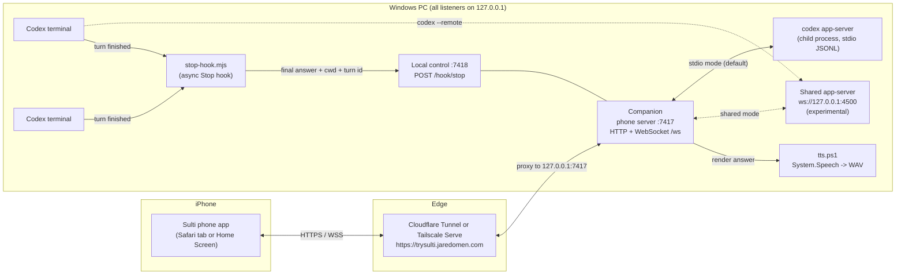

# Architecture

Sulti is two programs. The **companion** runs on the Windows PC and is the only part that talks to Codex. The **phone app** is a small web app the companion serves; the iPhone opens it over HTTPS through a Cloudflare Tunnel (production, `https://trysulti.jaredomen.com`, see [DEPLOY.md](DEPLOY.md)) or Tailscale Serve. Nothing runs in the cloud except Codex itself and the tunnel.

## The two halves

**Listen.** Every finished Codex answer reaches the companion by one of two routes:

- **Sessions the companion runs.** It drives `codex app-server` itself, and `TurnTracker` (`apps/companion/src/turns.ts`) picks the `final_answer` agent message from `item/completed`.
- **The owner's own terminals.** A Stop hook (`scripts/hooks/stop-hook.mjs`) posts `last_assistant_message`, `cwd` and `turn_id` to the local control port.

Answers are deduplicated by turn id, stored in the data folder (capped at 200), and pushed to the phone. The phone reads them aloud in one of two modes:

- **Mode A, phone voice.** Web Speech on the phone, fed as a queue of chunks of at most 250 characters.
- **Mode B, PC audio.** The companion renders a 16 kHz mono WAV with Windows `System.Speech`. The phone plays it through a signed, expiring URL, with Media Session controls for the lock screen and AirPods.

**Talk.** The phone sends what the owner typed or dictated as an `utterance`. The companion runs the intent router (`packages/core/src/router.ts`) against the configured sessions and the active session's skills. The result is one of three intents:

- **Prompt.** A Codex turn on the right session. "Run the tests" becomes a prompt to Codex. Sulti never runs a shell command itself.
- **Codex action.** A skill invocation, goal set, get, pause, resume or clear, or an interrupt.
- **App action.** Switching sessions, playback, copying, or showing approvals.

The companion runs prompts and Codex actions, and it switches sessions itself when the router resolved a session id. The phone runs playback, copy and approval actions locally. When the router isn't sure (`needsConfirm`), the phone shows a confirm sheet, and nothing runs until the owner taps.

## Components

| Path | What it does |
|---|---|
| `packages/core` | Pure TypeScript shared by both sides: the wire contract (zod schemas for every phone and companion message), the intent router, fuzzy matcher, prompt cleanup, and the markdown-to-speech normalizer and chunker. Browser-safe. |
| `packages/protocol` | Types generated from the installed Codex (`codex app-server generate-ts`), plus a JSON-RPC client over stdio or WebSocket with a 13-method allowlist. |
| `apps/companion` | The CLI (`npm start`, `npm run pair`, `npm run devices`), the phone server (static app, `/api/pair`, signed audio, `/ws`), the local control server (Stop hook, pairing codes), the app-server manager, the session registry, the answer store, TTS and clipboard helpers. |
| `apps/phone` | Vite + React app built from the Sulti design. Screens: connect, sessions (with "Needs you"), session details (goal, live "Right now" activity, skills, Stop), the reader (highlights the sentence being spoken, tap any sentence to jump), and talk (a live "Sulti will send" preview from the same router). Sheets for approvals, settings, sessions, skills, threads and copy. Self-hosted Atkinson Hyperlegible fonts, no UI or router libraries, no service worker. |
| `scripts/hooks` | The Stop hook and its installer. The installer is never run by the build; the owner runs it after review. |
| `tools` | Secret scan, the shared-session lab (T5) and the speech-to-text bench (T6). |
| `test` | A mock app-server (JSONL over stdio, scripted scenarios), fixtures shaped like a real capture, and integration tests that run the real companion against the mock. |

## Ports and data

All listeners bind to `127.0.0.1`:

- **7417.** The phone server. This is the only port the tunnel (or Tailscale Serve) exposes.
- **7418.** Local control for the Stop hook and `npm run pair`. It requires a shared secret and is never proxied.
- **4500.** The optional shared app-server.

The data folder is `%APPDATA%\sulti`, or `SULTI_DATA_DIR`. Nothing in it is ever committed, and the secret scan refuses these file names. It holds:

- **`config.json`:** `publicUrl`, the ports, the mode and the TTS voice and rate.
- **`sessions.json`:** the configured projects.
- **`secrets.json`:** the hook secret and the audio-URL signing secret.
- **`devices.json`:** SHA-256 hashes of device tokens.
- **`threads.json`:** which thread belongs to each session.
- **`answers/`:** stored answers and their cached WAV files.

## Security model

- **Reachability.** Every listener binds to `127.0.0.1`. In production a Cloudflare Tunnel makes only the phone server public at `https://trysulti.jaredomen.com`; Cloudflare provides the certificate and terminates HTTPS. With Tailscale Serve instead, only the owner's tailnet devices can reach it.
- **Pairing.** A pairing code works once and expires after 10 minutes. It's shown in the companion console as a link and QR code, or printed by `npm run pair`; a companion running in the background never logs codes. Failed attempts are limited to 5 per minute per visitor (Cloudflare's `CF-Connecting-IP`). Pairing gives the phone a device token, and the PC stores only its hash. The WebSocket must authenticate within 5 seconds, and the server checks `Origin` against `publicUrl`. A revoked or unknown token closes the socket with 4401, including an open one, and the phone returns to the pairing screen.
- **Command allowlist.** The JSON-RPC client can send only 15 allowlisted methods. `thread/shellCommand`, `command/exec*` and `process/*` are unreachable by construction.
- **Approvals.** These arrive as cards and are answered only by a tap on Approve or Decline. The router maps "approve" and "yes do it" to *show approvals*, never to an approval.
- **Audio URLs.** They're HMAC-signed and expire after 10 minutes. HTML is `no-store`, the CSP allows only same-origin scripts, and HSTS is sent when `publicUrl` is HTTPS.
- **Unlisted sessions.** A terminal folder that isn't in `sessions.json` shows up as an unlisted session. Sulti can read its answers but never sends it prompts.

## Shared mode

By default the companion owns its Codex sessions, through one `codex app-server` child over stdio. Shared mode (`"mode": "shared"` in `config.json`) connects instead to a WebSocket app-server that terminals can also join with `codex --remote`. A turn started from the phone then shows up live in the terminal, and the reverse also works. T5 verified the core of this. The WebSocket transport is still experimental in Codex, and in shared mode the companion leaves approvals for threads it doesn't own to the client that does. See `docs/REPORT.md` for the result and recommendation.
