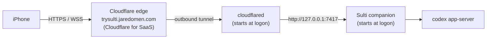

# Deploying Sulti on Cloudflare

Production Sulti is your PC plus a Cloudflare Tunnel. The companion keeps running on your Windows PC, and Cloudflare gives it a permanent HTTPS address, **https://trysulti.jaredomen.com**, that your iPhone can open from anywhere. Nothing is uploaded to Cloudflare Pages or Workers, because Sulti has to run next to Codex on the PC. When the PC is off or asleep, the phone shows "Can't reach your PC" until it's back.



The tunnel is outbound from your PC, so there are no open ports on your router. Only the phone server (7417) is exposed. The local control port (7418) and the shared app-server (4500) must never be routed through the tunnel.

## 0. Test before you deploy

```powershell
npm ci
npm run build
npm run typecheck; npm test; npm run scan
npx playwright-core install chromium webkit   # once
npm run e2e        # every phone flow in Chromium and WebKit, mock Codex, no cost
npm run e2e:live   # real Codex through a temporary Cloudflare tunnel, 2 short turns
```

All four must pass. `e2e:live` uses a throwaway data folder, so your own sessions, phones and chats are untouched.

## 1. How the address reaches your PC

`jaredomen.com`'s DNS stays on Vercel, so your portfolio, its subdomains, the ChatGPT sites and email are untouched. Cloudflare reaches your PC through a domain that's already on your Cloudflare account, and serves `trysulti.jaredomen.com` with **Cloudflare for SaaS** (100 custom hostnames are free on every plan):

| Piece | Where | Value |
|---|---|---|
| Tunnel `sulti` | Cloudflare account | Routes `sulti-origin.bizello.app` and `trysulti.jaredomen.com` to `http://127.0.0.1:7417` |
| `sulti-origin.bizello.app` | Cloudflare DNS (`bizello.app`) | Proxied CNAME to the tunnel; the SaaS **fallback origin** |
| Custom hostname `trysulti.jaredomen.com` | Cloudflare for SaaS on `bizello.app` | Cloudflare issues its certificate |
| `trysulti` CNAME | Vercel DNS (`jaredomen.com`) | `sulti-origin.bizello.app` |
| `_cf-custom-hostname.trysulti` TXT | Vercel DNS | The ownership value Cloudflare shows for the custom hostname |

One-time setup in the Cloudflare dashboard: open `bizello.app`, **SSL/TLS**, **Custom Hostnames**, **Enable Cloudflare for SaaS**. The rest (tunnel, records, fallback origin, custom hostname) can be done through the API or dashboard.

The alternative is moving `jaredomen.com`'s nameservers to Cloudflare and publishing the tunnel there directly. That works too, but every Vercel subdomain, the ChatGPT site records and the Resend email records would have to be copied over first.

## 2. Run the tunnel on the PC

Save the tunnel's token (dashboard: the tunnel, **Configure**, the install command's token) to `%APPDATA%\sulti\tunnel-token`. The token is a secret; keep it out of the repo and chats. Step 5 then runs `cloudflared` at logon for you, with no administrator rights. Check the tunnel shows **Healthy** in the dashboard and that `https://sulti-origin.bizello.app/api/health` answers. If it stays down, the PC must be able to reach Cloudflare on outbound port 7844.

If you prefer a Windows service that runs before logon, run `cloudflared service install <TOKEN>` in an administrator PowerShell instead, and delete the `tunnel-token` file so the startup task doesn't start a second copy.

## 3. Cloudflare settings for this hostname

Defaults are fine except for these, which break Sulti if they're on:

- **Rocket Loader:** off. It rewrites script tags, and Sulti's Content-Security-Policy blocks the rewritten scripts.
- **HTML caching:** leave the default. Don't add a "Cache Everything" rule for `trysulti.jaredomen.com`; the app shell must stay `no-store`. Hashed files under `/assets/` are already marked immutable and cache safely.
- **Bot Fight Mode / Super Bot Fight Mode:** off for this hostname. A challenge page can't be solved by a WebSocket or the Home Screen app.
- **WebSockets:** on (the default).
- **Always Use HTTPS:** on.

## 4. Point the companion at the new address

Create or edit `%APPDATA%\sulti\config.json` (see `apps/companion/config.example.json`):

```json
{ "publicUrl": "https://trysulti.jaredomen.com" }
```

The phone's origin must match `publicUrl` exactly, or the companion refuses the WebSocket and pairing.

## 5. Start Sulti at logon

```powershell
powershell -ExecutionPolicy Bypass -File scripts\production\install-startup.ps1 -DryRun   # preview
powershell -ExecutionPolicy Bypass -File scripts\production\install-startup.ps1
```

This registers two scheduled tasks that run hidden as you and restart within 5 seconds if they exit: **Sulti companion** (as you, so PC voice and "copy to PC" reach your desktop) and, when the token file exists, **Sulti tunnel**. The tunnel logs to `%APPDATA%\sulti\tunnel.log`. Output goes to `%APPDATA%\sulti\companion.log`, and the previous run is kept as `companion.log.old`. In the background the companion never writes pairing codes to the log.

## 6. Pair the iPhone

```powershell
npm run pair
```

Open the link on the iPhone in Safari, check the code matches, tap **Connect**. Then **Share**, **Add to Home Screen**. iOS gives the Home Screen app its own storage, so run `npm run pair` again and pair it once more.

## 7. Verify

- https://trysulti.jaredomen.com/api/health returns `{"ok":true,...}`. You can point an uptime monitor at it.
- The phone shows your PC's name in green on the Sessions screen.
- Work through [MANUAL_TESTS.md](MANUAL_TESTS.md) on the iPhone: lock-screen audio, AirPods controls and dictation can only be checked on the device.

## Running it

| Task | How |
|---|---|
| Logs | `%APPDATA%\sulti\companion.log`, and `hook-errors.log` for the Stop hook |
| Restart | `Stop-ScheduledTask 'Sulti companion'; Start-ScheduledTask 'Sulti companion'` (same for `'Sulti tunnel'`) |
| Update | `git pull; npm ci; npm run build`, run the tests from step 0, then restart |
| Roll back | `git checkout <previous commit>; npm ci; npm run build`, then restart |
| Pair another phone | `npm run pair` |
| Remove a phone | `npm run devices -- list`, then `npm run devices -- revoke <id>`. Its open connection closes within 30 seconds. |
| Stop serving | `Stop-ScheduledTask 'Sulti tunnel'`, or delete the custom hostname in Cloudflare |
| Uninstall | `install-startup.ps1 -Uninstall`; delete the custom hostname, the tunnel and `sulti-origin` in Cloudflare; delete the two `trysulti` records in Vercel |

## What's public, and what protects it

Anyone can load the app shell and `/api/health`. Everything else needs a paired phone:

- **Pairing** needs a 10-character one-time code from your PC that expires after 10 minutes. Wrong guesses are limited to 5 per minute per visitor, so a stranger can't lock you out.
- **The WebSocket** needs a device token, must authenticate within 5 seconds, and must come from `publicUrl`'s origin.
- **Audio links** are HMAC-signed and expire after 10 minutes.
- **Codex** is only ever sent prompts; Sulti can't run shell commands, and every approval needs a tap.

Cloudflare terminates HTTPS, so your prompts and answers pass through Cloudflare's edge decrypted, as they would for any site behind Cloudflare. If you want traffic that only your own devices can see, Tailscale Serve (in the README) is the alternative. For a second lock in front of the whole site, you can add Cloudflare Access later; the Home Screen app then needs to sign in to Access as well.

