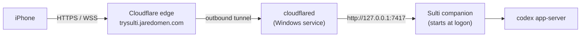

# Deploying Sulti on Cloudflare

Production Sulti is your PC plus a Cloudflare Tunnel. The companion keeps running on your Windows PC, and Cloudflare gives it a permanent HTTPS address, **https://trysulti.jaredomen.com**, that your iPhone can open from anywhere. Nothing is uploaded to Cloudflare Pages or Workers, because Sulti has to run next to Codex on the PC. When the PC is off or asleep, the phone shows "Can't reach your PC" until it's back.



The tunnel is outbound from your PC, so there are no open ports on your router. Only the phone server (7417) is exposed. The local control port (7418) and the shared app-server (4500) must never be routed through the tunnel.

## 0. Test before you deploy

```powershell
npm ci
npm run build
npm run typecheck; npm test; npm run scan
npx playwright-core install chromium webkit   # once
npm run e2e        # every phone flow in Chromium and WebKit, mock Codex, no cost
npm run e2e:live   # real Codex through a temporary Cloudflare tunnel, 2 short turns
```

All four must pass. `e2e:live` uses a throwaway data folder, so your own sessions, phones and chats are untouched.

## 1. Move jaredomen.com's DNS to Cloudflare (one time)

A tunnel hostname only works when the domain's DNS is on Cloudflare. Today `jaredomen.com` uses Vercel's nameservers (`ns1.vercel-dns.com`), and a wildcard record sends every subdomain, including `trysulti`, to Vercel. Moving DNS is free and keeps the portfolio on Vercel; only the DNS host changes.

1. In the Cloudflare dashboard, **Add a domain**, enter `jaredomen.com`, pick the **Free** plan.
2. Cloudflare imports the existing records. Make sure the apex (`jaredomen.com`) and `www` records point at Vercel: open the domain in Vercel's **Domains** settings and use the A and CNAME values Vercel shows for a domain on external DNS. Set those records to **DNS only** (grey cloud), which is what Vercel recommends so it keeps issuing its own certificates. Keep the domain added in Vercel.
3. Delete the imported wildcard (`*`) record unless you use other subdomains on Vercel. It isn't needed for Sulti either way, because a specific `trysulti` record overrides it.
4. At the registrar where you bought `jaredomen.com`, replace the two Vercel nameservers with the two Cloudflare nameservers shown in the dashboard.
5. Wait for Cloudflare to mark the domain **Active** (minutes to a few hours), then open https://jaredomen.com to check the portfolio still loads.

## 2. Create the tunnel

These steps follow Cloudflare's [dashboard tunnel guide](https://developers.cloudflare.com/cloudflare-one/networks/connectors/cloudflare-tunnel/get-started/create-remote-tunnel/). The dashboard labels move now and then; the guide has the current ones.

1. Cloudflare dashboard, **Networking**, **Tunnels**, **Create a tunnel**, name it `sulti`.
2. Choose Windows. Copy the install command it shows and run it in an **administrator** PowerShell. It installs `cloudflared` as a Windows service that starts with Windows and restarts itself:

   ```powershell
   cloudflared service install <TOKEN-FROM-THE-DASHBOARD>
   ```

   The token is a secret. Don't paste it into the repo or a chat.
3. Open the tunnel, **Routes**, **Add route**, **Published application**: hostname `trysulti.jaredomen.com`, service URL `http://127.0.0.1:7417`. Cloudflare creates the DNS record for you.
4. Check `sc query cloudflared` shows **RUNNING**, and the tunnel shows **Healthy** in the dashboard. If it stays down, the PC must be able to reach Cloudflare on outbound port 7844.

## 3. Cloudflare settings for this hostname

Defaults are fine except for these, which break Sulti if they're on:

- **Rocket Loader:** off. It rewrites script tags, and Sulti's Content-Security-Policy blocks the rewritten scripts.
- **HTML caching:** leave the default. Don't add a "Cache Everything" rule for `trysulti.jaredomen.com`; the app shell must stay `no-store`. Hashed files under `/assets/` are already marked immutable and cache safely.
- **Bot Fight Mode / Super Bot Fight Mode:** off for this hostname. A challenge page can't be solved by a WebSocket or the Home Screen app.
- **WebSockets:** on (the default).
- **Always Use HTTPS:** on.

## 4. Point the companion at the new address

Create or edit `%APPDATA%\sulti\config.json` (see `apps/companion/config.example.json`):

```json
{ "publicUrl": "https://trysulti.jaredomen.com" }
```

The phone's origin must match `publicUrl` exactly, or the companion refuses the WebSocket and pairing.

## 5. Start the companion at logon

```powershell
powershell -ExecutionPolicy Bypass -File scripts\production\install-startup.ps1 -DryRun   # preview
powershell -ExecutionPolicy Bypass -File scripts\production\install-startup.ps1
```

This registers a scheduled task, **Sulti companion**, that runs hidden as you (so PC voice and "copy to PC" reach your desktop) and restarts the companion within 5 seconds if it exits. Output goes to `%APPDATA%\sulti\companion.log`, and the previous run is kept as `companion.log.old`. In the background the companion never writes pairing codes to the log.

## 6. Pair the iPhone

```powershell
npm run pair
```

Open the link on the iPhone in Safari, check the code matches, tap **Connect**. Then **Share**, **Add to Home Screen**. iOS gives the Home Screen app its own storage, so run `npm run pair` again and pair it once more.

## 7. Verify

- https://trysulti.jaredomen.com/api/health returns `{"ok":true,...}`. You can point an uptime monitor at it.
- The phone shows your PC's name in green on the Sessions screen.
- Work through [MANUAL_TESTS.md](MANUAL_TESTS.md) on the iPhone: lock-screen audio, AirPods controls and dictation can only be checked on the device.

## Running it

| Task | How |
|---|---|
| Logs | `%APPDATA%\sulti\companion.log`, and `hook-errors.log` for the Stop hook |
| Restart | `Stop-ScheduledTask 'Sulti companion'; Start-ScheduledTask 'Sulti companion'` |
| Update | `git pull; npm ci; npm run build`, run the tests from step 0, then restart |
| Roll back | `git checkout <previous commit>; npm ci; npm run build`, then restart |
| Pair another phone | `npm run pair` |
| Remove a phone | `npm run devices -- list`, then `npm run devices -- revoke <id>`. Its open connection closes within 30 seconds. |
| Stop serving | Pause the tunnel in the dashboard, or `Stop-Service cloudflared` |
| Uninstall | `install-startup.ps1 -Uninstall`, `cloudflared service uninstall`, delete the tunnel and its DNS record |

## What's public, and what protects it

Anyone can load the app shell and `/api/health`. Everything else needs a paired phone:

- **Pairing** needs a 10-character one-time code from your PC that expires after 10 minutes. Wrong guesses are limited to 5 per minute per visitor, so a stranger can't lock you out.
- **The WebSocket** needs a device token, must authenticate within 5 seconds, and must come from `publicUrl`'s origin.
- **Audio links** are HMAC-signed and expire after 10 minutes.
- **Codex** is only ever sent prompts; Sulti can't run shell commands, and every approval needs a tap.

Cloudflare terminates HTTPS, so your prompts and answers pass through Cloudflare's edge decrypted, as they would for any site behind Cloudflare. If you want traffic that only your own devices can see, Tailscale Serve (in the README) is the alternative. For a second lock in front of the whole site, you can add Cloudflare Access later; the Home Screen app then needs to sign in to Access as well.
